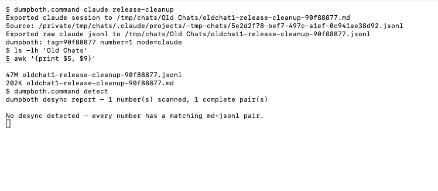

# dumpboth

Save your AI coding chat as `.md` + `.jsonl`, on one matching name.

The `.md` is readable. The `.jsonl` is the raw session. Both land in `~/Old Chats/`
as `oldchatN-<tag>.md` and `oldchatN-<tag>.jsonl`, so the pair can't drift apart.



## Use

Run from inside your agent's session, or from a shell right after it.

```sh
./dumpboth.command                  # Claude Code
./dumpboth.command codex
./dumpboth.command cursor
./dumpboth.command devin
./dumpboth.command gemini
./dumpboth.command opencode
./dumpboth.command codex mytag      # oldchatN-mytag-<tag>
./dumpboth.command detect           # report .md/.jsonl pairs that lost a half
```

Pass `home` or a directory to choose where `Old Chats/` goes. Default is home, never
current folder.

## Which session gets saved

| Agent | Session picked |
|---|---|
| Claude Code | current session |
| Codex | current task when run inside it, else newest |
| Gemini CLI | newest |
| OpenCode | newest, or `OPENCODE_SESSION_ID` |

Set `DUMPBOTH_BLOCK_DIR` to refuse writing into one folder.

## Add an agent

Make `agents/<name>/` with `agent.toml` (header, resume command), `turn.py` (one record to
role and text), and `session.sh` (print session file). No core edits.

## Test

```sh
python3 tests/run_tests.py          # synthetic chats in throwaway HOME
agents/devin/tests/test-normalize
```

## Needs

macOS with `bash` and `python3` (3.11+). Scripts read each agent's local
session files and never upload anything.

## See also

[DBV](https://github.com/towelWet/dbv): Mac viewer for saved Claude chats.

[dumpconvert](https://github.com/towelWet/dumpconvert): turn saved chats into a training dataset.

## License

MIT
