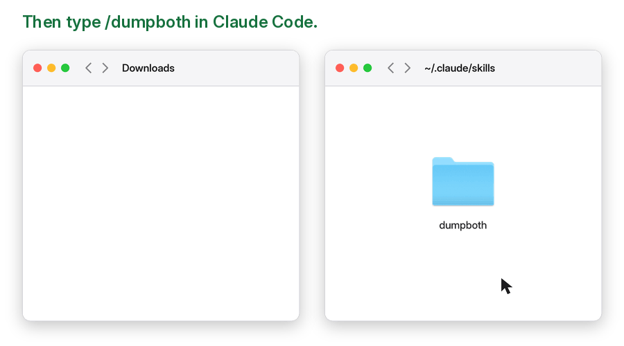

# dumpboth

dumpboth saves your AI coding chat as `.md` + `.jsonl`.


## Easy install

For example, Claude Code:

Drag this repo into ~/.claude/skills



Can't see `.claude`? Press Cmd+Shift+. in Finder.

## Use

```text
/dumpboth
/dumpboth mylabel
```

Your chats land in `~/Old Chats/`.

## Also see

[DBV](https://github.com/towelWet/dbv), a Mac chat viewer for your saved Claude chats.

[dumpconvert](https://github.com/towelWet/dumpconvert) turns them into a training dataset.
